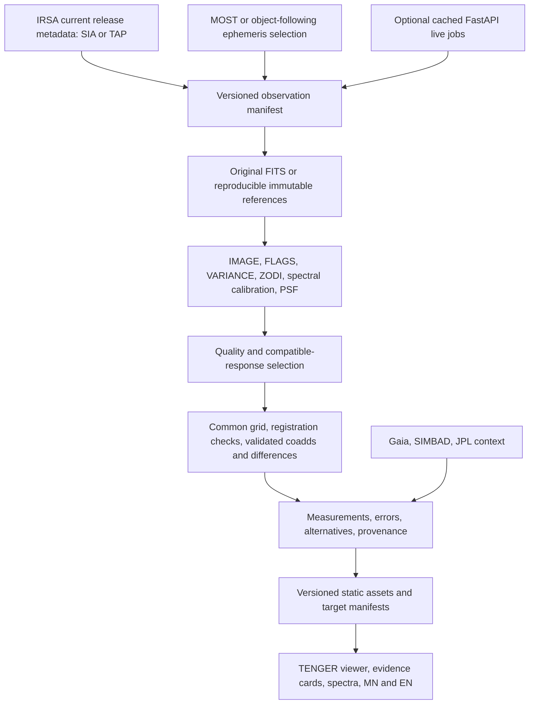

# TENGER: repository audit, science review, and development roadmap

Audit date: 14 November 2026, Asia/Ulaanbaatar. This is an audit and proposal, not an implementation or deployment. The supplied application source was left unchanged.

## 1. Decision and project understanding

**Keep the existing application. Repair its science and release handling before expanding it into TENGER.** It already has a useful static-data viewer, coordinate parsing, target shortcuts, image comparisons, charts, and tests. A framework rewrite would spend time without resolving the most consequential defects.

TENGER's mission is to let the public investigate real SPHEREx observations: enter coordinates, inspect changes across dates, measure evidence, and understand plausible causes in Mongolian or English. The official minimum is a public coordinate-based time-series tool, tested on the five named targets. The strategy adds explanations, a curated feed, spectra, a Planet X laboratory, and an artificial-source game.

Evidence labels used throughout:

- **OFFICIAL:** read in a NASA, IRSA/IPAC, service-owner, or original research source.
- **STRATEGY:** present in the supplied 16-page strategy PDF; not automatically scientifically established.
- **REPOSITORY:** observed in the supplied code or assets.
- **TESTED:** executed in this audit, with the scope stated.
- **RECOMMENDATION:** proposed work or design, not an existing feature.
- **UNKNOWN:** not established by this audit; no success is implied.

**OFFICIAL:** The [challenge](https://www.spaceappschallenge.org/2026/challenges/planet-x-and-spherex/) explicitly requires coordinate input and an image sequence and names Barnard's Star, Epsilon Indi B, WISE 0855, RW Aurigae, and R Draconis. Its extra considerations include wavelengths, image addition/subtraction, field of view, overlays, metadata, and coordinate URLs. I retrieved the official page directly; its streamed page data contained the full Details and Resources text even though the plain HTML text view initially showed only its title.

**STRATEGY:** All 16 PDF pages were extracted; pages 6 and 10 were also rendered and inspected, including the target comparison and architecture diagram. The PDF's eight-target objective is an expansion of the five-target core. Its Planet X detectability and distance-from-motion statements require the corrections below.

## 2. Repository condition and verification

### Architecture actually present

The supplied folder is an extracted source snapshot without local Git history. Its structure matches the public [pythonhack000/spherex-blink](https://github.com/pythonhack000/spherex-blink) repository, but a commit-identical comparison was not performed. Do not assume ownership of that account or that this snapshot is your team's original work.

| Area | Inspected implementation | Assessment |
|---|---|---|
| Frontend | `static/index.html`, CSS, 11 browser JS modules | Plain JavaScript, Canvas images, inline SVG charts; no React/Vite or frontend package manifest needed |
| State | `static/js/main.js`, about 1,452 lines | Central mutable state and event wiring; functional but increasingly difficult to extend |
| API | `backend/api.py`, FastAPI | Parse, resolve, observe, job polling, binary frames, WISE, Gaia, HiPS proxy |
| Archive | `backend/archive.py` | Real IRSA SIA discovery/search and documented cutout URL pattern; release parser is outdated |
| Processing | `backend/processing.py` | Astropy WCS, NumPy, SciPy bilinear resampling, ZODI subtraction, masks, approximate channel assignment |
| Analysis | `static/js/science.js`, `stack.js` | Aperture measurements, empirical errors, centroids, bootstrap scatter, motion fit, median stacks |
| Prepared assets | `static/data` | 22 targets; five required targets each contain 150 encoded frames; approximately 118 MB overall |
| Cache | `data` | Approximately 68 MB; search results, Gaia data, 1,241 processed NPZ files; no original SPHEREx FITS found in the supplied snapshot |
| Build | `scripts/bake.py`, `build_site.py`, `results.mjs` | Offline acquisition, encoded image payloads, thumbnails, and derived results |
| Deployment | Dockerfile, Render configuration, Pages/bake Actions | Static Pages plus optional FastAPI server; deployment configuration inspected, not executed |
| License | Root `LICENSE` | MIT, copyright SPHEREx Blink contributors; preserve notice and document reuse |

The browser downloads compressed int16/asinh image arrays and masks and computes many results locally. Coordinate text entry currently calls the live parser and then opens a custom live job even when the position overlaps a prepared target; the static path is chosen by target key. Add prepared-field lookup and local coordinate parsing so the core coordinate demonstration can remain fast without waking Render. The WebP files are thumbnails, not a complete set of prepared per-visit science frames. The nominal “Sum” uses median stacking, so its label and explanation do not accurately describe its operation.

### What actually ran

| Check | Result | What that establishes |
|---|---|---|
| Existing Python suite | **54 passed** | Existing unit expectations pass with installed dependencies |
| Existing JavaScript suite | **39 passed** | Pure image, coordinate, motion, and viewport calculations pass their fixtures |
| Local FastAPI launch | **Passed** | Application served locally at port 8765 |
| Coordinate API | **Passed** | Decimal and sexagesimal WISE inputs parsed; RA 361 and Dec -91 rejected with 422 |
| Browser interaction | **Passed, scoped** | Home, Barnard static viewer, playback state, side-by-side layout, difference-mode selection, WISE toggle, EN/RU toggle observed |
| Prepared binary integrity | **Passed for five required targets** | Decompressed byte lengths match metadata and image dimensions |
| Current SIA archive searches | **Passed** | Ten DR1/QR3 requests returned parseable CSV, including an empty QR3 result for WISE 0855 |
| Current TAP join | **Passed** | `spherex.artifact` joined to `spherex.plane`; spatial predicate returned a real DR1 URI/time row |
| DR1 cutout and existing loader | **Passed with a critical masking defect** | Real FITS downloaded and read; flag decoder fails to recognize its definitions |
| One QR3 cutout | **Failed** | HTTP 503 on this attempt; no claim of successful QR3 pixel retrieval |
| Public supplied site | **HTTP 200** | Homepage reachable; no complete public-site regression run |
| Public Render parse API | **Passed** | Returned the correct WISE sexagesimal conversion; not a full archive-to-frame test |
| Aladin + DR1 cube diagnostic | **Inconclusive** | Library initialized, but sky remained blank and browser logged a fetch error |
| Docker build, complete rebake, deployment | **Not run** | These remain acceptance work |

Tests were run in an isolated audit environment with bytecode/cache writes disabled for the source folder. Current dependencies were installed from the repository's unbounded minimum-version requirements. This verifies one environment, not reproducibility across all future versions. Python 3.12 was used. A dependency lock and a network smoke check should be added.

The tests do **not** establish scientifically valid real-target photometry or motion. For example, a passing test currently endorses falling back to a neighboring channel. That behavior contradicts strict time-comparison requirements.

## 3. Complete ideal-product comparison

Statuses: **Working/scoped** means tested only as described above; **Partial** means real implementation exists but does not meet the full requirement; **Unverified** means code exists without a matching audit execution; **Missing** means no implementation was found.

| Ideal feature | What the repository currently has | Status | Missing work | Priority |
|---|---|---|---|---|
| RA/Dec input | Backend decimal/sexagesimal parser, combined search field | Working/scoped | Offline parsing for prepared fields; clearer examples; validate URL ranges | P0 |
| Field-of-view selection | 3, 6, 12, 30 arcmin controls; API bounds | Partial | Changing FOV leaves prepared path; verify live result and failure handling | P0 |
| Five official shortcuts | All five buttons and prepared folders | Working/scoped | Run complete per-target acceptance, retain all five | P0 |
| Real SPHEREx data | Actual archive access, cached QR2/QR3 frames | Partial | Reprocess using DR1/QR3 and validate target detections | P0 |
| Time-series viewer | Dated visit stacks and static payload decoder | Working/scoped | Show visit time ranges and spectral compatibility | P0 |
| Blink, play/pause, timeline | Automatic playback, date buttons, endpoint/range selection | Working/scoped | Reset stale selections; complete multi-target regression | P0 |
| Basic image comparison | Single/side-by-side; difference control | Working/scoped | Strict compatible input selection; swipe is missing | P0 |
| Wavelength and observation metadata | Wavelength UI, dates, internal obsId/release, flag percentages | Partial | Display source filename/product, release, full provenance, explicit flags | P0 |
| Valid explanation per supported target | Motion result and generic explanations; relative wing curves | Partial | Evidence cards, alternatives, limitations, reliable variability assessment | P0 |
| Mongolian/English toggle | English/Russian resources in JS | Missing for required pair | Complete MN translation resources, dynamic states, terminology review | P0 |
| Mobile-friendly interface | Responsive CSS; narrow layout observed | Partial | Fix observed narrow overflow; real phone and touch/keyboard testing | P0 |
| Prepared static public demo | Five required plus 17 other fields | Partial | Current releases, quality gates, portable backend settings, public regression | P0 |
| Difference images | Raw subtraction of median visit stacks | Partial / scientifically unsafe defaults | Same response, registration/PSF checks, propagated errors and masks | P1 |
| Image addition/stacking | Per-pixel median; labeled “Sum” | Partial | Honest labels; controlled matched-band weighted coadds if needed | P1 |
| Gaia or known-object overlays | Gaia DR3 positions, motion propagation, static Gaia records | Partial | IDs/parallaxes/errors; live query regression; Solar System matching absent | P1 |
| Spectral fingerprint | Aperture spectrum with points/errors; universal molecule labels | Partial | Science calibration, inspection/provenance, valid channels, target-specific labels | P1 |
| Planet X Lab | No lab or physics controls | Missing | Adopt defensible geometry and band-specific brightness/sensitivity model | P1 |
| Shareable coordinate URL | `ra`, `dec`, `fov`, `target`, `embed` | Partial | Encode observation/mode/band/version; restore state accurately | P1 |
| Measurements and uncertainties | Annulus noise, bootstrap centroid scatter, control stars | Partial | VARIANCE, correlated noise, PSF/calibration errors, conservative verdicts | P1 |
| Hide-the-Planet | No game | Missing | Artificial-source pipeline, disclosure, selection/reveal/scoring | P2 |
| Public detection-rate graph | No trial persistence or statistics | Missing | Blank trials, sample design, uncertainty intervals, privacy-aware aggregation | P2 |
| GIF export | PNG download only | Missing | Export bounded animation with credits and metadata | P2 |
| Any-coordinate live querying | Implemented FastAPI jobs | Partial | DR1 repair, current flags, admission limits, timeouts, deployment configuration | P2 |
| Advanced 3D sky visualization | Aladin 2D spherical sky navigation | Missing | Only after core requirements pass | P2 |
| Additional catalogues / advanced overlays | AllWISE context and basic Gaia overlay | Partial | Known-object checks, provenance, optional relevant catalogues | P2 |

Additional screen gaps: no TENGER identity, eight-change feed, swipe comparator, dedicated evidence-card view, Lab, game, or full About/Data Sources page. Existing home target cards and inline limits text are useful foundations. The sky map uses **AllWISE**, not SPHEREx coverage or the DR1 cube.

## 4. Scientific audit: defects and unsupported claims

### Critical: current release discovery loses DR1

**REPOSITORY + TESTED:** `backend/archive.py` recognizes only `spherex_qrN` collections; configuration falls back to QR2/QR3. Parsing the current service description returned only QR3 and QR3-deep, ignoring DR1. `exposure_key` also assumes numeric QR releases. The bundled five-target frames include QR2, and WISE 0855 is entirely QR2.

**OFFICIAL:** [IRSA's release guidance](https://caltech-ipac.github.io/spherex-archive-documentation/spherex-data-releases/) says DR1 and QR3 supersede QR2 and use consistent improved processing; QR2 is no longer searchable. Simply enabling DR1 is insufficient: release identity, deduplication, cache keys, processing versions, and fixtures must change together. Otherwise new bakes can omit the older observing baseline while stale data conceal the problem.

### Critical: DR1 flags are silently ignored

**TESTED:** A real DR1 D6 Barnard-field cutout contained `MSKN0000=TRANSIENT`, corresponding `MSKM` bitmasks, and other named definitions. The code searches only `MP_` keys. In its 12 x 12 FLAGS image, the code rejected **0/144** pixels; **17/144** carried one or more named hazard flags, including **2 OVERFLOW** pixels. This is a direct compatibility failure, not a hypothetical risk.

**RECOMMENDATION:** Decode flags from the actual release schema, distinguish informational and invalidating bits, fail closed on unrecognized schema, and retain bit-level reasons. Test both historical and DR1/QR3 headers. The “Exclude flagged pixels” option currently starts unchecked; motion crops discard masks, and aperture flux includes flagged aperture values while only marking the result. These analysis paths need their own quality rules.

### Critical: spectral matching is not enforced

**REPOSITORY:** `stack.js:resolveBand` picks the closest available channel. `main.js:paintFresh` resolves it independently within each visit, so a nominally fixed selection can show different channels at different dates. Default difference mode turns a composite into an all-wavelength stack. Neither equal detector numbers nor approximate channel labels guarantee equal spectral response.

`processing.py:channel_index` assigns 17 logarithmic bins per detector instead of using official channel maps. `binSpectrum` uses a different global logarithmic binning rule. The actual cube metadata supplies a calibrated wavelength array and explicitly identifies two blank dichroic frames; a “102 usable channels everywhere” presentation is unwarranted.

**OFFICIAL:** [Spectral calibration documentation](https://irsa.ipac.caltech.edu/data/SPHEREx/docs/spherex_spectral_calibrations.html) supplies channel maps and transmission curves and notes the x-axis flip for detectors 4–6. The [data-product guide](https://caltech-ipac.github.io/spherex-archive-documentation/spherex-data-products/) reserves WCS-WAVE for visualization and recommends CWAVE/CBAND science calibration.

**RECOMMENDATION:** Determine a common spectral response or declared tolerance before making a time-comparison pair. An absent channel should produce an unavailable state, not a substitute. Label broadband composites as qualitative context. Reject unsupported differences.

### High: uncertainty, photometry, registration, and saturation

- **REPOSITORY:** VARIANCE and EPSF are not carried into analysis. Error bars use background scatter with a native-pixel approximation; they omit several instrumental, calibration, resampling, and background-estimation terms.
- Spatial WCS reprojection exists, but no measured registration residual, PSF matching, or photometric scaling gates protect subtraction. Bilinear interpolation also spreads contributions from invalid pixels beyond a nearest-neighbor mask.
- Every cutout has ZODI and then a median level removed. This is useful for compact-source display but changes the background zero point and can affect extended emission; record it explicitly.
- `isSaturated` treats a majority of generically flagged aperture measurements as saturation. Contamination does not establish saturation. Wing measurements can depend on wavelength and PSF changes; wing curves currently set their errors to zero.
- `bandPoints` filters light curves by detector even for a selected channel. RW Aurigae's “faded about 2x” hook and R Draconis's brightening hook are not supported by controlled same-response photometry with uncertainties.
- Motion combines broad wavelength sets, ignores parallax, starts from catalogue-propagated positions, uses just 12 bootstrap rounds, and has ad hoc uncertainty floors. Field controls help diagnose problems but do not validate a categorical “motion is real” conclusion.
- The prepared results table and viewer use different sample selection: `results.mjs` measures all decoded frames, while the viewer applies `wellCovered`. Barnard's stored value was 10.01 +/- 0.63 arcsec/year; the browser displayed 9.90 +/- 0.66. Both are provisional and should use one declared measurement pipeline.
- At the supplied approximate distances, stellar parallax is of order 0.4–0.6 arcsec, with potentially larger two-epoch differential effects. Calling it negligible for subpixel astrometry is not justified without an error-budget comparison.
- `chart.js` draws H2O, CH4, CO2, and CO markers for every target. These must be labeled reference wavelengths, not detections; water-vapor and water-ice features must not be conflated.

**RECOMMENDATION:** For the first release, publish conservative measurements only when quality gates pass. Otherwise provide a catalogue-based expectation and “insufficient evidence for a reliable measurement.” Do not generate confidence percentages. A source measured near a catalogue prediction is not a blind recovery.

### High: incomplete provenance and misleading timing

**REPOSITORY:** Frame metadata retains obsId, MJD, detector, release, approximate wavelength, and aggregate flag percentage. It drops original FITS filename/URL, calibration version, processing history, source hash, flag definitions, and uncertainty products. Search-cache URLs provide some reproducibility, but the browser and exported PNG lack a complete trace.

Visits can span up to 75 days, yet are labeled by one mean date. Show actual start/end times and member exposures. Moving-object studies need much shorter time bins or an explicit motion model.

The most prominent fast-star previews compare AllWISE 2010 against SPHEREx 2026 and stretch the missions separately. The homepage caption discloses both missions, which is good. Still, these are context images with different responses, resolutions, units, and timing; keep them distinct from quantitative SPHEREx comparisons. AllWISE coadd timing is currently approximated by one mean year.

## 5. Data feasibility: required and extra targets

**TESTED:** Searches used each repository target's propagated field center, a 0.001-degree SIA search radius, MAXREC 5000, and the wide-survey DR1 and QR3 collections. Counts below are **image records**, not independent visits, clean detections, or a complete usable spectrum. Deep collections were not included in these fresh counts. All five have current-release coverage.

| Target | Bundled frames / visit groups | Bundled releases | Fresh DR1 records | Fresh QR3 records | Feasibility judgment |
|---|---:|---|---:|---:|---|
| Barnard's Star | 150 / 4 | QR2, QR3 | 239 | 119 | Strong starting point for a motion investigation; saturation and wavelength-dependent centroid checks required |
| Epsilon Indi B | 150 / 5 | QR2, QR3 | 340 | 120 | Available; close-system blending and catalogue source identity need review |
| WISE 0855 | 150 / 3 | QR2 only | 258 | 0 | DR1 preserves a multi-epoch baseline; faint/confused-source validation needed, especially at short wavelengths |
| RW Aurigae | 150 / 3 | QR2, QR3 | 226 | 109 | Suitable coverage for a variability investigation; existing factor-of-two claim remains unvalidated |
| R Draconis | 150 / 7 | QR2-wide/deep, QR3-deep | 413 | 126 | Wide plus optional deep coverage; guard against saturation, visit binning, and inconsistent spectral sampling |

The bundled date spans run from 2025 into 2026. Fresh DR1 WISE coverage spans 5 May 2025–14 May 2026; a zero QR3 result at this position does **not** mean no observations or no object.

**TESTED:** The challenge's WISE position converts to RA **133.7951291667 degrees**, Dec **-7.2451472222 degrees**. The preset stores nearly that historical coordinate with an epoch and proper motion, then centers on a later predicted position. Keep the original coordinate, epoch, and propagated search center distinct in the interface.

| Additional target | Evidence actually obtained | What remains before calling it a demo |
|---|---|---|
| Makemake | JPL Horizons returned a 15 August 2025 geocentric position, V approximately 17.14 and observer distance approximately 53.31 AU; a fixed-coordinate SIA search returned 283 DR1 / 115 QR3 records | Object-following exposure selection, wavelength match, actual source recovery, uncertainties, and repeat detections |
| Pluto | Horizons returned V approximately 14.45 and observer distance approximately 34.38 AU at that epoch; fixed-coordinate SIA returned 266 / 56 records | Same checks; a six-month excursion can leave a small fixed cutout |
| 3I/ATLAS | Official IRSA observation table downloaded and parsed: **259 rows**, with per-exposure comet coordinates, times, product URLs, and collection identifiers | Select and inspect a usable matched pair; low SNR and extended coma invalidate a generic point-source photometry assumption |
| Replacement candidate: 433 Eros | Skyshift's source documents a two-exposure candidate and image references | Independently download and validate it before promoting; its claimed SNR is not adopted as our result |

The extra-target fixed-position queries are **not** evidence that the moving object appears in every returned image. They were preliminary coverage probes at one ephemeris position, not MOST track searches. No supplied prepared folders exist for Makemake, Pluto, or 3I/ATLAS.

**OFFICIAL:** The [3I/ATLAS resource page](https://irsa.ipac.caltech.edu/data/SPHEREx/docs/comet3iatlas/index.html) provides a stronger starting dataset than a generic fixed-position query and cautions that many wavelengths have low SNR and that the comet is extended. It advises against applying the point-source Spectrophotometry Tool to this comet.

**RECOMMENDATION:** Bake and validate the five required targets first. Treat the other three slots as provisional. Do not fill an eight-card feed with unverified changes. Preserve an honest unavailable card or use an independently verified asteroid.

## 6. Planet X Lab: corrected scientific specification

**STRATEGY:** The PDF says a six-month jump yields distance and Planet Nine is 3–5 magnitudes below a single SPHEREx exposure. Neither should ship as an unconditional conclusion.

### Motion

The coefficient follows from 2 radians-in-arcseconds: 2 x 206264.806 = 412529.6 arcsec. Thus 412,500/d is a rounded **maximum projected six-month parallax-style displacement** under a 2-AU baseline, a distant approximately stationary object, and favorable projection. It is not a general inversion of two measured positions.

A better educational model uses the observer baseline projected perpendicular to the line of sight:

`displacement_arcsec ≈ 206264.806 × |B - n(n·B)| / distance_AU`

For a circular Earth-orbit illustration, `|B| = 2 |sin(pi × interval_days / 365.25)| AU`. Include viewing direction, clearly identify geocentric versus spacecraft observer assumptions, and add orbital motion for ephemeris comparisons. At one year the simplified observer baseline returns near zero; the interface must not increase parallax linearly forever.

At 300–1000 AU, the maximum six-month estimate is about 1375–413 arcsec. At 625 AU it is about 660 arcsec (11 arcmin), already larger than the default 6-arcmin field. Pluto and Makemake have still larger excursions under this simplified geometry. This creates a real field-of-view and object-following requirement; a small fixed stamp cannot guarantee both positions.

### Brightness and radius

The supplied H–diameter–albedo relation is a **visual-band** relation using visual geometric albedo. `V ≈ H + 5 log10(r Δ)` neglects phase correction. Radius, reflectance spectrum, geometry, and thermal assumptions must be declared. Mass alone does not determine reflected brightness.

**OFFICIAL:** Section 3.1 of the [AKARI Planet Nine paper](https://arxiv.org/html/2506.12854v1) discusses `M ≈ 3 M_earth (R/R_earth)` as a relation used by Brown and Batygin, tracing it to Kepler-planet work by Wu and Lithwick. It is an assumed population relation, not a measured Planet Nine radius or a universal mass-radius law. Offer independent radius control and an optional explicitly named empirical model.

**OFFICIAL:** In [Crill et al.](https://arxiv.org/html/2404.11017v1), the sensitivity table points to Figure 2, whose caption describes sensitivity at completion of **four surveys**. This does not substantiate the PDF's attribution of AB 18.4 to a single exposure.

More fundamentally, a predicted **V magnitude cannot be directly subtracted from a near-infrared AB magnitude limit**. A band-specific spectral model and current per-band sensitivity or measured recovery curve are needed. Therefore “3–5 magnitudes too faint” is not a verified result of this audit. Neither “Pluto yes” nor “Makemake near the limit” follows solely from their V magnitudes.

For N equal, independent, background-limited measurements, ideal SNR improves as sqrt(N), corresponding to `1.25 log10(N)` magnitudes; N=4 gives 0.753 mag. Four surveys are not necessarily four equivalent exposures. Moving sources need tracking, and confusion/systematics can prevent this gain.

**RECOMMENDATION:** The Lab can show calculated motion and visual brightness now as an educational proposal. Until an infrared model is validated, display **“SPHEREx detectability not determined by this visual-brightness model.”** Planet Nine remains hypothetical; no discovery or guaranteed Rubin outcome should be claimed.

### Detection statistics and the game

The PDF's 0.1-degree native image estimate is numerically reasonable: `(360/6.15)^2 ≈ 3426` pixels. Multiplying by the one-sided Gaussian tail above 5 sigma yields approximately 0.001 expected pixel exceedances under independent Gaussian assumptions. A two-sided test changes the tail probability; resampling changes independence. This is not a validated candidate false-alarm rate.

For a later game, preserve originals, inject PSF-shaped artificial flux into copies, record trial conditions and elapsed time, and disclose simulation on every play/reveal. Include blank trials to estimate false positives. Show binomial uncertainty and only fit a 50% recovery point when the sampled curve brackets it. A casual-player threshold is specific to the images, interface, and participant sample.

## 7. Reference repositories and reuse assessment

Public metadata, licenses where present, READMEs, trees, and selected code were inspected. These external projects were **not built or independently scientifically validated**. Do not treat their READMEs as test evidence. The very large Driftnet recursive-tree request was truncated; a subsequent directory query and selected file retrieval succeeded.

| Repository / owner | Verified status and license | Actual contents inspected | Recommendation and limits |
|---|---|---|---|
| [SPHEREx Blink / pythonhack000](https://github.com/pythonhack000/spherex-blink) | Public, MIT; upstream push 9 Nov 2026 | Supplied full local source, tests, data and UI; upstream root/license/manifest | Primary base to preserve; strongest compatibility; repair defects in this report |
| [Driftnet / epsretriever](https://github.com/epsretriever/spherex-planet-x) | Public, MIT; push 14 Nov | README, root and pipeline listings, Python project manifest, frontend manifest, `injection.py`, `pairs.py`, `planet_nine.py` | Study explicit injection/recovery intervals and pair-ranking controls; Python pipeline + Next/React + Worker is much heavier. Selected pair code says same wavelength “when possible”; do not inherit it as our scientific gate. Existing study claims remain unverified here |
| [SPHEREx / mateibut](https://github.com/mateibut/SPHEREx) | GitHub API and page returned 404 | No source accessible | No license/build/science assessment possible; no reuse recommendation |
| [Chrono & Spatial / ProgrammerJibon](https://github.com/ProgrammerJibon/NasaAppChallenge2026ChronoSpatial) | Public, MIT; push 13 Nov | README, 454-file tree, package file, actual `DifferenceView.tsx` | Useful comparison-mode layout and difference caveat; Next/Express/database architecture is not a reason to migrate. A component displaying significance does not establish correct significance calculations |
| [SkyBlink / ratulhasanruhan](https://github.com/ratulhasanruhan/Space_App_Challenge) | Public; no root license identified | README, 349-file tree, pipeline `core/run.py`, IRSA provider | IRSA provider is explicitly unverified/stubbed and returns empty/placeholders; pipeline provenance says simulated. Do not use as a verified real-data connector or copy without licensing permission |
| [Skyshift / kamikaze1120](https://github.com/kamikaze1120/skyshift) | Public, Apache-2.0; push 14 Nov | README, license, 29-file tree, candidate-target document | At inspected revision, process/research documents rather than application code. Eros references are useful research leads; no ready viewer to import. Preserve attribution and applicable notices for any reuse |
| [spherex-prospector / MertAkm](https://github.com/MertAkm/spherex-prospector) | GitHub API returned 404 | No source accessible | Ownership as named in PDF only; no reuse or scientific-validity claim |

No current count of approximately 100 related repositories was established. No competitor is assumed disqualified because of pre-event activity. Existing-code attribution and current rules must govern your own submission.

## 8. External services and library audit

“Reachable” refers to this audit only. A page HTTP status is not an end-to-end integration test. Public documentation generally permits unauthenticated access, but rate limits, CORS, queues, and fair-use rules still apply.

| Resource and actual URL | Official / access observed | Provides; authentication; limitations; reuse |
|---|---|---|
| [IRSA SPHEREx](https://irsa.ipac.caltech.edu/Missions/spherex.html) | Official; retrieved | Mission entry point and tools; public; data acknowledgement required |
| [SIA](https://irsa.ipac.caltech.edu/SIA) | Official; live queries passed | Image records, DR1/QR3/deep/cube collections; no login used; inspect body, truncation, ingestion lag |
| [TAP sync](https://irsa.ipac.caltech.edu/TAP/sync) | Official; actual join passed | Exposure metadata and catalogue queries; public; preserve query and response, avoid assuming schema permanence |
| [Cutout documentation](https://caltech-ipac.github.io/spherex-archive-documentation/spherex-data-access/) | Official; one DR1 FITS passed, one QR3 request 503 | Append documented center/size parameters to returned access URL; public; retries/timeouts and content validation needed |
| [MOST](https://irsa.ipac.caltech.edu/applications/MOST) | Official; UI entry retrieved | Moving-object footprint search; no completed track search in this audit; use for moving targets rather than fixed positions |
| [Spectrophotometry link](https://irsa.ipac.caltech.edu/applications/spherex/tool-spectrophotometry) | Linked by official mission page, returned 404 here | Do not claim working integration. Confirm current landing path with IRSA; point-source applicability excludes extended comet assumptions |
| [DR1 HiPS properties](https://irsa.ipac.caltech.edu/data/hips/SPHEREx/spherex_allsky_cube/properties) | Official; HTTP 200, parsed | 102 spectral slices, calibrated wavelength list, blank dichroic frames; visualization cube, not a time sequence |
| [Horizons API](https://ssd-api.jpl.nasa.gov/doc/horizons.html) | JPL official; four ephemeris requests passed | Ephemerides and distances; public; serial queries, caching, documented observer frame. Sample geocentric results are not precision spacecraft predictions |
| [SB Identification](https://ssd-api.jpl.nasa.gov/doc/sb_ident.html) | JPL official documentation read; example API request timed out | Field/time known-object candidates; no login used; configure correct observer, uncertainty and magnitude limits; not integrated |
| [Gaia archive](https://gea.esac.esa.int/archive/) | ESA official landing page retrieved | Astrometry, proper motion, parallax, errors; simple public data available without login; authenticated facilities may have other requirements. Repository uses IRSA's Gaia mirror; a late live catalogue probe timed out |
| [SIMBAD](https://simbad.cds.unistra.fr/simbad/) | CDS official URL; request returned 404 here | Object identity/catalogue context; actual service query not verified. Repository also has Sesame resolver fallbacks |
| [SkyBoT](https://ssp.imcce.fr/webservices/skybot/) | Service-owner documentation retrieved | Known Solar System identification; public interfaces documented; no actual cone result tested |
| [AllWISE IBE](https://irsa.ipac.caltech.edu/ibe/search/wise/allwise/p3am_cdd) | Official endpoint present in code; bundled data observed | W2 image context; a late live IBE search probe timed out; different bandpass, units, epoch, and resolution from SPHEREx |
| [Aladin Lite](https://aladin.cds.unistra.fr/AladinLite/) | Official; library initialized in the app | Sky navigation; existing version 3.8.2 loaded from CDN; 3.8.2 package metadata declares GPL-3, while its shipped LICENSE and current upstream LICENSE contain LGPL-3.0 text; resolve this inconsistency before redistributing; preserve attribution and applicable notices |
| [WWT documentation](https://docs.worldwidetelescope.org/) and [engine](https://github.com/WorldWideTelescope/wwt-webgl-engine) | Official docs/repository inspected | Tours, layers, and reusable renderer; engine MIT; inspiration for guided exploration, not needed alongside existing Aladin |
| [NASA Eyes on Asteroids](https://eyes.nasa.gov/apps/asteroids/#/watch/2026_vs11) | Official web route reached loading shell | Time/camera/object presentation reference; its interactive camera behavior and named object were not verified here; no source-code reuse claim |
| “Astrophy tools” | Exact wording confirmed in official challenge, intended resource unresolved | Do not invent a package or silently rename it. Ask for the intended link; Astropy is separately established and already used |

Library recommendation: retain Python, Astropy, NumPy, SciPy, Pillow, FastAPI/httpx, Canvas, and SVG. Consider `reproject` and `photutils` only where they improve the validated workflow; neither library automatically solves calibration, covariance, or PSF mismatch. Astroquery/PyVO are useful documented archive clients, but replacing an already adequate HTTP layer is optional. No new chart library or frontend framework is necessary for P0.

### HiPS feasibility finding

The official [HiPS notebook](https://caltech-ipac.github.io/irsa-tutorials/spherex-hipscube/) demonstrates Firefly and direct FITS access. This establishes the dataset's access route, not automatic Aladin compatibility. The independent local Aladin diagnostic loaded the library but showed a blank map with `Failed to fetch`. The failure's cause was not isolated; do not label it a proven Aladin limitation or a successful cube integration. The main app's AllWISE sky map did initialize.

**RECOMMENDATION:** Time-box a browser/network investigation, verify resource/CORS behavior and slice controls, and keep the existing context map if unresolved. Do not block the time-series viewer on a full-sky cube.

## 9. Visual and interaction assessment and proposed layouts

**TESTED:** The actual app has a dark black/navy background, amber emphasis, large image panels, six array thumbnails, a motion/spectrum side panel, and a timeline/control deck. Its homepage has five animated target cards and a results table. This is observed UI, not an invented comparison with a finished TENGER design.

Useful elements: immediate target entry, obvious Play control, coordinate URL updates, strong image contrast, and a working comparison mode. Existing charts and limits text provide a base for evidence presentation.

Problems: the science verdict is more prominent than its limitations; source products and release are absent from the frame label; dense controls compete with the primary action; a “Sum” label misstates a median; universal spectral feature annotations imply unsupported interpretation; the main motion card can remain English after changing language. A narrow responsive test reported effective viewport width 300 CSS pixels and document width 440; another view measured 603/603. Requested desktop/phone viewport overrides were not consistently reflected in the tab measurements, so a complete 1440-pixel desktop or physical 390-pixel-phone sign-off is **not** claimed. Physical devices, pinch zoom, screen readers, and full keyboard navigation remain untested.

**RECOMMENDATION: proposed screen structure**

1. **Sky Feed:** TENGER title, MN/EN switch, coordinate search and FOV, five mandatory cards first. Each card has category, actual epoch range, spectral match, availability, and a restrained measured-change statement. Add extra targets only after validation.
2. **Investigation:** large image, persistent observation/wavelength/release/source strip, Play and timeline immediately beneath. Blink, side-by-side, swipe, and validated difference as one mode row. Put contrast and extra display settings in a secondary panel.
3. **Why did it change?:** adjacent on wide screens, below the viewer on phones. State observation, measurement with units/errors, plausible cause, alternatives, quality limitations, and sources. Never use an unsupported confidence percentage.
4. **Spectrum:** independent tab with points, uncertainties, units, usable-channel count, per-point provenance, and declared reference markers. Keep a time dimension available for variable sources.
5. **Explore:** context sky browser clearly labeled by survey; relevant catalogues optional. Keep spectral cube slices separate from visit dates.
6. **Planet X Lab:** motion and visual-brightness calculators with assumptions, followed by an honest detectability statement. Game remains separately labeled artificial-source training.
7. **About/Data Sources:** provenance, acknowledgement, DOI, reused code/licenses, processing limitations, and AI disclosure.

Phone acceptance should use 360, 390, and 768 CSS-pixel widths and actual touch devices. Keep the image, date, band, and Play together; collapse detailed settings; preserve readable Mongolian labels and adequate tap targets.

## 10. Top five improvements

Estimates are planning assumptions for one experienced developer; downloads, scientific validation, and translation review can extend them. They are not a promised schedule.

| Rank | Improvement | Challenge / science / visual value | Estimate | Main risk |
|---:|---|---|---|---|
| 1 | Migrate archive selection and flag decoding to current DR1/QR3; version caches and rebake five targets | Essential relevance; critical validity; restores trustworthy baseline | 3–6 engineering hours plus archive time | Long download queues; changed product schemas |
| 2 | Enforce compatible spectral pairs; gate differencing; carry variance and quality | Critical validity; reliable blink is the core experience | 5–10 hours, scoped to selected demo bands | No usable pair in a requested band; covariance/PSF work |
| 3 | Build evidence cards and complete frame provenance; remove categorical unsupported claims | Main TENGER differentiator; high judging/presentation value | 3–6 hours after validated measurements | Weak detections require an honest inconclusive card |
| 4 | Complete MN/EN localization and verify mobile flows | Required accessibility/local impact; obvious product improvement | 4–8 hours plus native review | Scientific terminology and long dynamic strings |
| 5 | Turn the existing target cards into a fast TENGER feed and rehearse a public static demo | High visual and presentation value; reuses working assets | 2–4 hours after data approval | Temptation to add unvalidated movers or depend on live APIs |

The Planet X Lab comes after those gates. A polished explanation of an uncertain result is preferable to a visually dramatic but unsupported detection.

## 11. Proposed architecture and data flow

**RECOMMENDATION:** Preserve plain JavaScript and FastAPI. Keep the public core static; use the server only for explicitly selected live investigations. Split the current central module as features grow, rather than introducing React solely for organization.

Data contract: each observation retains archive, collection/release, product ID, exact filename/URL, observation start/mid/end times, exposure duration, detector, calibrated wavelength/bandwidth, units, original flags/definitions, processing version, calibration references, original-data hash when retained, and derived-product parents. A stack lists every contributing exposure, valid coverage, effective response, weighting, mask, and uncertainty method. “No measurement,” “masked,” and “no archive coverage” are distinct states.

Storage: keep original FITS outside the public site or retain immutable source references plus checksums and a deterministic recipe. Use compact preview images for instant viewing, and load numeric arrays only when measurements are needed. Never perform scientific measurements on bloom/sharpened thumbnails. Record the existing lossy encoding if decoded arrays remain analysis inputs; preferably precompute measurements from original precision.

API: validate finite coordinate/FOV values, configure base URL for the actual deployment, and restrict CORS to intended origins. `api.js` currently selects the Render server only for `github.io`; a static Vercel deployment would otherwise attempt local `/api` routes. The backend's origin list is also hardcoded. `MAX_JOBS_IN_MEMORY` bounds retained jobs, not running threads or queued downloads; add actual admission limits/cancellation before broad public live use. Use errors that distinguish empty coverage from archive failure or zero successful downloads.

Deployment: retain GitHub Pages for prepared assets and optional Render for live mode unless there is a concrete reason to change. Bake into a staging directory, validate before replacing the prior good dataset, then publish atomically. Existing workflows do not run the test suites before baking/publishing. Add a compact build gate and keep the last known-good dataset. Test public URLs in a signed-out browser. Do not deploy unreviewed changes during this audit.

URL proposal, extending the existing query format:

`?ra=...&dec=...&fov=0.1&target=barnard&mode=blink&band=...&obs=...&data=...&lang=mn`

Retain `embed=1`. Use stable observation/product identifiers, version interpretation explicitly, validate every parameter, and preserve backwards compatibility. Do not let a target key silently override conflicting user coordinates; define precedence and report the resolved investigation. Exact new parameter names are recommendations until implemented and tested.

## 12. P0–P3 roadmap and acceptance criteria

Complexity: S about 1–3 focused hours, M about 3–8 hours, L one or more working days. These are estimates, not current completion claims. Existing filenames below are repository-relative; proposed new files are explicitly identified.

| Stage / task | Files involved | Data and dependencies | Complexity / risk | Acceptance criterion |
|---|---|---|---|---|
| P0-A Current release acquisition | `backend/archive.py`, `config.py`, `jobs.py`, archive tests | Current SIA/TAP and DR1/QR3 identities | M; cache collisions and missing baseline | DR1/QR3/deep discovered, obsolete releases excluded by policy, duplicates handled, cache versioned, real query smoke test passes |
| P0-B Flags and measurement inputs | `processing.py`, `framestore.py`, `jobs.py`, processing tests | Current real FITS flags, variance, spectral calibration, PSF references; P0-A | M–L; schema mistakes | Both historical/current flag fixtures pass; real DR1 hazard pixels recognized; unknown schema rejected; variance retained |
| P0-C Honest blink pairing | `stack.js`, `main.js`, `plate.js`, build script, JS tests | P0-B and verified overlap at selected wavelengths | M; insufficient compatible epochs | No implicit channel substitution; each displayed pair declares response and times; unavailable requests stay unavailable |
| P0-D Rebuild the five-target demo | `scripts/bake.py`, `build_site.py`, `results.mjs`, `static/data/*` | P0-A/B/C, downloadable sources, provenance schema | L/archive-bound; 503s and saturation | Five mandatory targets open without a live server; each has real frames, a quality decision, and complete source trace; failed bake preserves prior assets |
| P0-E Evidence cards and provenance | `main.js`, `science.js`, `chart.js`, HTML; proposed target evidence JSON | Validated measurements or explicit insufficiency; P0-D | M; overinterpretation | Every required target answers what/measurement/observations/cause/alternatives/reliability/next data; no unsupported variability factor or molecular detection |
| P0-F Full MN/EN | `i18n.js`, `names.js`, HTML, target strings; proposed separate language resources | Native terminology review; P0-E copy | M; dynamic states missed | Every user-visible state and accessible label covered; switch updates existing result cards and charts; no missing-key fallback visible |
| P0-G Responsive and public acceptance | CSS, HTML, viewer modules, deployment configuration/workflows, README | P0-D/E/F; actual hosting/domain | M; device/network behavior | Tested input, target opening, playback, timeline, basic compare, errors at 360/390/768 and desktop; no page overflow; signed-out public demo works |
| P1-A Validated difference and stacking | `processing.py`, `stack.js`, `plate.js`, `science.js`, tests | Variance, PSF/registration checks, P0-C | L; correlated residuals | Matched pairs only; declared median/weighted coadd; uncertainty/mask products and false-change controls verified |
| P1-B Catalogue and known-object context | `gaia.py`, `resolver.py`; proposed JPL client/context module | Gaia IDs/parallaxes/errors, SIMBAD, Horizons/SBIdent; P0 manifests | M–L; observer geometry/service outages | Sources and epochs preserved; known-object result states explicit; failure is not “unmatched”; no discovery label |
| P1-C Spectral fingerprint | `chart.js`, `science.js`, spectral pipeline; proposed measurement JSON | Calibration, usable samples and uncertainties; P0-B | L; incomplete or variable spectra | Inspectable points show units/errors/product/channel/time/quality; incomplete coverage honest; reference lines distinguished from detections |
| P1-D Share state and swipe | `main.js`, `viewport.js`, `plate.js`, HTML/CSS, URL tests | Stable products and P0-C | M; state ambiguity | Opening a copied URL restores object/coordinate/FOV/observation/mode/band; swipe uses compatible observations and works with keyboard/touch |
| P1-E Planet X Lab | Proposed `planet-lab.js`, physics tests and translations | Adopted geometry, radius/albedo model, band-specific sensitivity evidence | M for educational model; L for detectability | Unit-checked inputs/units, interval/projection assumptions visible; V and IR AB never directly compared; hypothetical status permanent |
| P1-F Extra feed investigations | `presets.py`, bake scripts, proposed evidence JSON | MOST/object tracks or official comet table, P0 quality gates | L; no recoverable source | Each added target independently validated at multiple times; original field and tracking mode distinguished; otherwise unavailable/replaced |
| P2-A Injection game | Proposed injection pipeline and game module, HTML/CSS/translations | Real preserved images, appropriate PSF, calibrated injection parameters | L; unrealistic point sources | User can blink/select/reveal; originals unchanged; every screen says artificial; score reproducible from trial parameters |
| P2-B Public recovery statistics | Proposed trial API/storage and statistics module | Game trials plus blank controls; P2-A | L; bias, bots, sparse samples | Detection/false-positive rates with counts and uncertainty; threshold only if bracketed; no universal-sensitivity claim |
| P2-C GIF and richer live mode | Export module; `api.js`, jobs/API/config | P0 pipeline, bounded jobs, actual backend domain | M–L; memory, cold starts, service load | Credited GIF reproduces selected compatible sequence; live queries have admission control, cancellation, timeouts and honest coverage errors |
| P2-D Advanced relevant overlays / 3D | `sky.js`, proposed optional overlay modules | Valid ephemerides/catalogues and resources | L; scope and rendering cost | Helps a specific investigation and preserves performance; never blocks the static core |
| P3-A Candidate validation | Proposed detection/linking/validation modules | Repeat detections, injection recovery, known-object checks | L/research; false positives | Registration/artifacts/multiple testing assessed; candidates require repeated evidence and remain “requires verification” |
| P3-B Release maintenance and educational scale | Workflows, provenance migrations, accessibility/content tools | Stable schema, translators, representative users | L; upkeep and changing APIs | Reproducible release updates, rollback, accessibility review, and documented scientific/translation ownership |

**Recommended approval scope:** P0-A through P0-G in small reviewable stages. Gate data/science work first, then explanations/localization/UI. Keep P1 features conditional on remaining time and verified data. P2/P3 should not consume the core viewer's acceptance time.

## 13. Submission, attribution, and remaining information

**OFFICIAL:** The retrieved [Judging & Awards Guide](https://www.spaceappschallenge.org/resources/judging-awards-guide/) uses **Impact, Creativity, Validity, Relevance, Presentation**, not the PDF's asserted replacement “Influence.” It lists Best Use of Data, Best Use of Science, Global Connection Award, and Local Impact Award among the awards. It specifies Sunday **15 November 2026, 11:59 p.m.** according to the team's Local Event. For a Ulaanbaatar team this is **15 November 2026 at 23:59 UTC+08:00**, subject to actual Local Lead instructions. The PDF's Sunday 18:00 feature freeze is an internal recommendation, not an official submission rule.

**OFFICIAL:** The [Project Submission Guide](https://www.spaceappschallenge.org/resources/project-submission-guide/) confirms a public externally hosted demo, video at most 30 seconds or deck at most seven slides including introductory slides, English submission materials, and English subtitles when video speech uses another language. Include sources, reused work, and accurate AI disclosure. A bilingual product must still provide an English judging path. I did not submit anything, inspect your team account, or verify local exceptions.

**OFFICIAL:** [DR1 overview](https://irsa.ipac.caltech.edu/data/SPHEREx/docs/overview_dr1.html) confirms DOI **10.26131/IRSA678** for spectral images and **10.26131/IRSA679** for the spectral all-sky cube. The required acknowledgement was retrieved and saved separately as `IRSA-acknowledgement.txt` for exact reuse. Add the requested NASA/JPL-Caltech/IPAC image credit as appropriate, and retain WISE, Gaia, CDS/Aladin and reused-code acknowledgements separately. MIT code licensing does not relicense the underlying survey imagery or every third-party component. Do not alter NASA logos.

### Precisely unresolved

- Team ownership, intended Git remote/domain, and permission to publish are not established. No publishing occurred.
- Corrected DR1/QR3 target products have not been fully baked or independently validated for all five targets; archive coverage is established, science acceptance remains work.
- No verified same-response Makemake/Pluto/Eros demo pair or measured motion-to-distance result exists from this audit. 3I/ATLAS products exist, but a suitable pair was not validated.
- Current Spectrophotometry landing link returned 404; SBIdent example timed out; SIMBAD root request returned 404. These observations do not prove global service outages.
- DR1 cube metadata works; direct Aladin rendering remains unresolved after a fetch failure.
- Full desktop, physical-phone, accessibility, cross-browser, Docker, and new-deployment acceptance remain unperformed.
- The intended “Astrophy tools” resource is ambiguous; provide its specific link if one is intended.
- The team's actual registration, project form, Local Lead instructions, and any local submission exceptions have not been checked.
- No validated band-specific Planet Nine SED and current single-exposure sensitivity comparison has been adopted. The universal “3–5 magnitudes too faint” claim must remain unverified.

### Approval checkpoint

Your pasted request, Parts 19–20, explicitly requires completing the audit and obtaining approval before implementation. **Approve the P0 repair scope above before source edits or restructuring.** No major rewrite is proposed. After approval, each stage should report changed files, source data, run instructions, tests passed/failed, and remaining limits.
